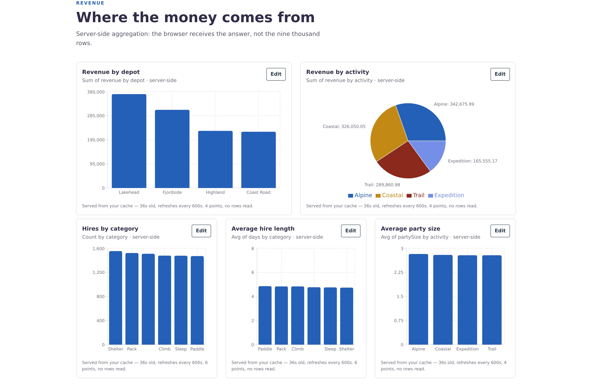

# Point It at an Object, Get a Dashboard

A schema-driven data-visualization **Client Extension** for Liferay. Drop the widget on a page,
point it at any Object, pick a dimension, a measure and a chart type, and it renders a live chart
from Headless data — **no per-chart code**. A dashboard is several widgets on one page; the page
builder is the layout.

The code behind the Liferay DevCon Deep Dive *Point It at an Object, Get a Dashboard*.



## How it works

1. **Read the definition.** The widget asks the object-admin API for the Object's fields and
   classifies them: text and picklists become dimensions, numbers become measures, dates become
   time dimensions. The config panel offers only what the schema allows, so a new Object works the
   moment it is published.
2. **Aggregate — and choose where.** The same pure `aggregate()` function runs in two places:
   - **In the browser**, over the entries the widget fetched. Liferay caps a page at 500 entries,
     and a browser chart reads one page.
   - **On the server**, in `object-aggregator`: a Node Client Extension that scans every page as
     the signed-in user and returns only the chart's points, cached per user for 10 minutes.
3. **State the denominator.** Every chart has a footnote saying what it counted — *all 400 rows*,
   *48,048 rows over 97 requests*, or a warning when the browser only saw the first 500 of 48,048.
   A chart built on 1% of the entries looks just as convincing as the right one; the footnote is
   how you tell them apart.

`types.ts`, `classify.ts` and `aggregate.ts` are **byte-identical** in the widget and the
aggregator, enforced by `npm run check:parity` before every build. That is the architectural claim:
the group-by never changes, only where it runs.

## What's in here

| Piece | Where | What it is |
|---|---|---|
| **object-dashboard** | `liferay-workspace/client-extensions/object-dashboard/` | The widget. `customElement` CX — React and Clay from the page's import map, Recharts for the charts. |
| **object-aggregator** | `liferay-workspace/client-extensions/object-aggregator/` | Server-side aggregation. Node/Express CX with its own OAuth2 application. Same chart config in, same points out. |
| **object-dashboard-site** | `liferay-workspace/client-extensions/object-dashboard-site/` | Site initializer: the *Object Dashboards* site, its pages and a style book. |
| **outfitter-site** | `liferay-workspace/client-extensions/outfitter-site/` | Site initializer: *Outfitter*, a complete demo site for an invented gear-hire company, with two brands as style books. See [`outfitter/README.md`](outfitter/README.md). |
| **demo Objects** | `demo-objects/` | Sales Order and Support Case definitions, and a seeder. |
| **Outfitter scripts** | `outfitter/` | Create and seed the Outfitter Objects, generate its pages and style books, switch brands. |

## Running it

Product: **Liferay DXP 2026.Q2** (`liferay-workspace/gradle.properties`).
Prerequisites: a JDK, Node 18+, Python 3 (standard library only), and a DXP activation key.

[`RUNBOOK.md`](RUNBOOK.md) is the detailed version of this: memory, start-up timing, a
verification block, and the traps that fail without an error.

**1. Start the portal**

```bash
cd liferay-workspace
./gradlew initBundle                       # downloads the bundle into bundles/
cp <your-activation-key>.xml bundles/deploy/
bundles/tomcat/bin/startup.sh
```

Sign in at **http://localhost:8080**. The setup wizard is disabled
(`configs/common/portal-setup-wizard.properties`). The commands below use `test@liferay.com` /
`pw`; use whatever you set.

**2. Deploy the extensions**, one at a time:

```bash
./gradlew :client-extensions:object-dashboard:deploy --rerun-tasks
./gradlew :client-extensions:object-aggregator:deploy --rerun-tasks
./gradlew :client-extensions:object-dashboard-site:deploy --rerun-tasks
./gradlew :client-extensions:outfitter-site:deploy --rerun-tasks
```

Avoid `blade gw deploy`: it redeploys everything, which mints the aggregator a new OAuth2 client id
and breaks server-side charts until you restart the aggregator.

**3. Create and seed the Objects**

```bash
cd ..
SO_COUNT=48048 TK_COUNT=400 \
BASE_URL=http://localhost:8080 LR_USER=test@liferay.com LR_PASS=pw python3 demo-objects/seed.py
python3 outfitter/objects.py               # the Outfitter site has to exist first
```

Seed real volume. With the seeder's small defaults every chart fits in one page, and the
difference between the two strategies — the point of the project — never shows.
[`demo-objects/README.md`](demo-objects/README.md) covers the seeder's options and `reset.py`.

**4. Run the aggregator**

A local bundle has nothing to run a service container, so this part is yours:

```bash
cd liferay-workspace/client-extensions/object-aggregator
npm install
. ./local-env.sh       # source it: reads the OAuth2 client id from the running portal
npm start
curl -s localhost:3002/ready
```

Re-source `local-env.sh` and restart after every aggregator deploy.

**5. Open the pages**

- `/web/object-dashboards/analytics` — Sales Order and Support Case, both strategies side by side
- `/web/object-dashboards/build` — an empty page to drop the widget on
- `/web/outfitter/operations` — the Outfitter dashboard

## Development

```bash
# widget
cd liferay-workspace/client-extensions/object-dashboard/dashboard-widget
npm run dev            # standalone Vite harness with mock Objects, no portal needed
npm test

# aggregator
cd liferay-workspace/client-extensions/object-aggregator
npm test               # build, parity check, and the scan-planning tests
```

**If you edit `aggregate.ts`, `classify.ts` or `types.ts`, copy them to the aggregator.** The build
fails until you do, on purpose:

```bash
cd liferay-workspace/client-extensions
cp object-dashboard/dashboard-widget/src/{types,classify,aggregate}.ts object-aggregator/src/
```

## Troubleshooting

| Symptom | Likely cause |
|---|---|
| Widget missing from the page editor | `dist/` is empty or stale — run `npm run build` in `dashboard-widget/` and redeploy |
| "Could not list Objects" | Not signed in, or `/o/object-admin/v1.0/object-definitions` returned 403 |
| An Object is missing from the dropdown | It is still a draft. The widget lists active Objects only |
| Server-side chart: 401 "Invalid authorization" | The aggregator holds a stale client id. Re-source `local-env.sh` and restart it |
| Server-side chart: 403 | That Object is not in the aggregator's OAuth2 `scopes`. Scopes are per Object and lowercase: `c_salesorder.everything.read` |
| A chart: 409 "Conflict with getObjectEntriesPage" | The Object is site-scoped, so its path needs `/scopes/<siteId>` |
| **Server bars differ from browser bars** | **Stop.** The scan stopped early — check that the entry response carries `totalCount` |
| Footnote always says "Served from your cache" | Expected for 10 minutes; the cache is per user |

More of these, all found the hard way, are in [`outfitter/README.md`](outfitter/README.md#things-that-fail-silently).

## What's next

- **A precomputed cube Object.** An Object Action keeps a small aggregate Object up to date on
  every write — region × category × month, with sum *and* count columns, never a stored average.
  The cube is just another Object, so the widget charts it unchanged, and it is small enough for
  the browser strategy to read whole. The widget already has the weighted average this needs.
- **Filter before aggregating.** Push date ranges and value filters into the Headless query, so a
  chart reads only what it needs.
- **Shareable chart configs.** Saved charts live in `localStorage`; a config Object would make
  them server-side and shareable.
- **Server-side reach.** OAuth2 scopes are declared per Object at build time, so the server
  strategy reaches only the Objects listed in `client-extension.yaml`. The browser strategy has no
  such limit. A 403 could fall back to the browser with a visible notice.

## Credits

The Outfitter site's photographs are from Unsplash — see
[`IMAGE-CREDITS.md`](liferay-workspace/client-extensions/outfitter-site/site-initializer/IMAGE-CREDITS.md).
